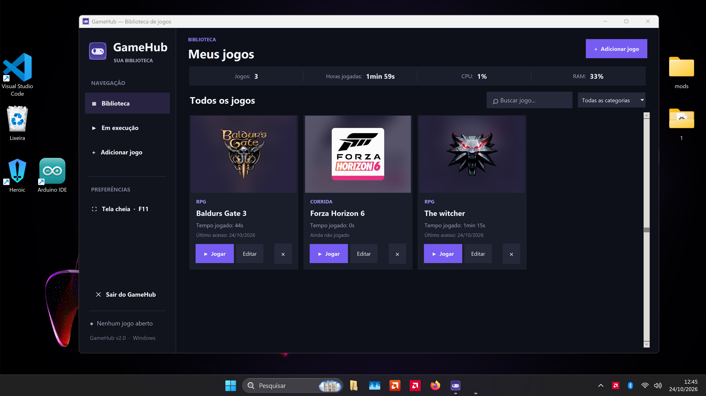

#O que é

O GameHub é um programa para organizar meus jogos em um lugar só, em vez vez de procurar o executável de cada jogo (não oficial digamos assim) em pastas diferentes, posso deixar tudo cadastrado em uma biblioteca e abrir o que quiser por ali.

Além de iniciar os jogos, o GameHub acompanha o tempo jogado e mostra algumas informações de desempenho do computador. O projeto é apenas para Windows e não precisa de conta, servidor ou configuração complicada.

#O que o faz?

Organiza os jogos: permite cadastrar o nome, a categoria, a capa e o caminho do arquivo .exe de cada jogo.

Abre os jogos: basta escolher um jogo da biblioteca e clicar em Jogar.

Registra as horas jogadas: acompanha o tempo das sessões iniciadas pelo GameHub.

Permite fechar o jogo: enquanto um jogo iniciado pelo GameHub estiver rodando, aparece a opção Fechar jogo, com uma confirmação para evitar encerramentos acidentais.

Mostra o uso do computador: exibe informações de CPU e memória RAM.

Facilita a busca: permite localizar os jogos cadastrados sem precisar navegar pelas pastas do Windows.

A interface abre em tela cheia. É possível usar F11 para alternar o modo de exibição e Esc para voltar à janela maximizada.

#O que preciso para usar?

Se você só quer jogar baixe o GameHub.exe disponibilizado no projeto e abra com dois cliques. Não precisa instalar nada para utilizar o executável já compilado.

Cadastre seus jogos informando onde está o .exe de cada um. O GameHub não instala nem baixa jogos: ele apenas organiza e abre os que já estão no seu computador.

Se você quer executar ou modificar o código

Você vai precisar de:

Python instalado no Windows;

os arquivos GameHub.pyw e requirements.txt;

um terminal (CMD ou PowerShell) para instalar as bibliotecas.

Na pasta do projeto, execute:

python -m pip install -r requirements.txt

Depois, abra o GameHub.pyw com o Python. Você também pode executá-lo com:

python GameHub.pyw

Se você quer gerar seu próprio executável

Com o Python instalado, execute criar_exe.bat. Ele instala as dependências necessárias para a compilação e gera o GameHub.exe na própria pasta do projeto, sem deixar as pastas temporárias de compilação.

Depois de criado, o executável pode ser aberto normalmente

## Capturas de tela

### Tela inicial

### Adicionar jogo

### Jogo em execução

